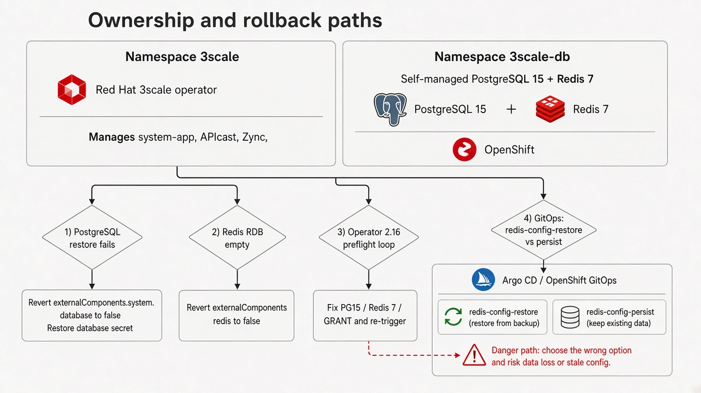

# Operación día 2

Tras marcar `externalComponents`, el **operador 3scale** sigue gestionando `system-app`, APIcast y Zync. Ya no gestiona PostgreSQL (system) ni Redis (system y backend). Quien opera el namespace `3scale-db` es dueño de esos Deployments, PVC, imágenes, backups y NetworkPolicy.

Copia para clonar el repo: `docs/runbooks/06-day-2.md`. Referencia corta: `docs/runbooks/04-ops-logs-persistencia-imagenes.md`.

!!! danger "Redis tiene que quedar en modo persistencia"
    El cutover usa `save ""` y `appendonly no` para que Redis cargue `dump.rdb` (`threescale.redis.configMode: restore` en `values-cutover.yaml`). Antes de devolver tráfico, `configMode: persist` entra con `values-215-external.yaml` (`save` + `appendonly yes`). `values-216-external.yaml` solo cambia el canal.
    Si el Pattern sigue en `values-cutover.yaml`, un restart **borra datos**.

## Checklist en régimen

- [ ] El ConfigMap de Redis tiene líneas `save` y `appendonly yes` (no `save ""`)
- [ ] `extraValueFiles` del Pattern es `/values-215-external.yaml` o `/values-216-external.yaml` (`threescale.redis.configMode: persist`)
- [ ] Los digest de imagen están anclados (PostgreSQL 15 y Redis 7), no el tag flotante
- [ ] Tamaño de PVC y `resources` coinciden con la carga de 2.15 (los valores de lab son ejemplos; no copiar el límite 32Gi de Redis de la guía)
- [ ] `threescale.backup.enabled` es una decisión. El chart trae un CronJob de `pg_dump` y `redis-cli SAVE` hacia el PVC `external-db-backup`, y ese CronJob queda apagado (`enabled: false`)
- [ ] Un VolumeSnapshot de un PVC con la base viva es crash-consistent. El CSI de EFS no implementa VolumeSnapshot, así que `system-storage` usa AWS Backup o una copia de archivos
- [ ] Backup de secrets `system-database`, `system-redis` y `backend-redis` en el namespace `3scale` **y** de `system-database` en `3scale-db`
- [ ] Hubo al menos un ejercicio de restore
- [ ] ClusterLogForwarder (o equivalente) recolecta stdout de los tres pods de BDD
- [ ] NetworkPolicy permite 5432 y 6379 **solo** desde el namespace de 3scale
- [ ] Hay pull secret de `registry.redhat.io` en `3scale-db`
- [ ] El on-call sabe que un drain de nodo o un rollout de imagen de estos Deployments es un corte (`Recreate`, 1 réplica, RWO)

## Quién opera qué

| Área | Responsable tras `externalComponents` |
|------|---------------------------------------|
| PostgreSQL y ambos Redis (pod, PVC, imagen, probes) | Quien opera las BDD (manifiestos / GitOps de `3scale-db`) |
| Secrets con los que 3scale se conecta | Vault, vía ExternalSecret. No editar a mano `system-database`, `system-redis` ni `backend-redis` |
| `system-app`, APIcast, Sidekiq, Searchd, Zync, `zync-database` | Operador 3scale |
| `system-storage` (RWX) | Operador 3scale / APIManager |

Borrar el `APIManager` **no** debe borrar los PVC de `3scale-db` (sin `ownerReferences`; GitOps `prune: false`). Borrar el namespace `3scale-db` **sí** borra los datos.

## Confirmar persistencia de Redis

```bash
oc -n 3scale-db get configmap redis-config-external -o yaml | grep -E 'save |appendonly'
```

Debe haber `save 900 1` (y el resto de `save`) y `appendonly yes`. **No** dejar `save ""` ni `appendonly no` después del cutover.

`threescale.redis.configMode: persist` entra con `values-215-external.yaml` y se mantiene en `values-216-external.yaml`. Dejar que el Pattern sincronice. Luego reiniciar:

```bash
oc -n 3scale-db rollout restart deployment/backend-redis-external deployment/system-redis-external
```

## Backups

| Componente | Qué copiar | PVC |
|------------|------------|-----|
| PostgreSQL | `pg_dump` (formato custom) a un volumen que no sea `postgresql-data-external` | `postgresql-data-external` |
| Redis backend | `redis-cli SAVE` y copiar `dump.rdb` fuera del volumen de la base | `backend-redis-storage-external` |
| Redis system | igual | `system-redis-storage-external` |

Guardar copia de los secrets de conexión. Tras un restore como usuario `postgres`, volver a aplicar el GRANT de PostgreSQL 15 ([GRANT CREATE en schema `public`](externalize-postgresql.es.md#grant-create-en-schema-public)).

!!! warning "No hay alta disponibilidad"
    Cada base es **una réplica**, `Recreate`, ReadWriteOnce. Red Hat no soporta Redis Cluster para 3scale. Un drain de nodo o un rollout de imagen es ventana de mantenimiento.

## Anclar y parchear digest de imagen

El operador 3scale ya no dispara ImageChange sobre estos Deployments. Anclar digest SHA-256 del [catálogo de Red Hat](https://catalog.redhat.com/). Este repo fija PostgreSQL 15 porque el preflight del operador exige ≥ 15.0, y Redis 7.2. Las imágenes son `registry.redhat.io/rhel9/postgresql-15` y `registry.redhat.io/rhel9/redis-7`.

Poner `threescale.images.postgresql` y `threescale.images.redis` en `values-global.yaml` con `registry.redhat.io/...@sha256:<digest>`. Procedimiento: [Anclar digest de imágenes](image-digests.es.md).

Inventario y rollout:

```bash
oc get deploy -n 3scale-db -o jsonpath='{range .items[*]}{.metadata.name}{"\t"}{.spec.template.spec.containers[0].image}{"\n"}{end}'
oc -n 3scale-db rollout status deployment/system-postgresql-external
oc -n 3scale-db rollout status deployment/backend-redis-external
oc -n 3scale-db rollout status deployment/system-redis-external
```

Un CVE de esas imágenes exige un rollout que se agenda. Es un corte de esa base. `maxmemory` y la política de eviction de Redis son una decisión de quien opera la base. Este repo no fija un valor.

## Capacidad

Los PVC de lab son `1Gi`. Los límites de memoria de lab son `2Gi`. Copiar requests, limits y `storage` de los Deployments embebidos de 2.15. No copiar el límite 32Gi de Redis de la guía oficial si producción usa menos.

Vigilar llenado de PVC y memoria de Redis. Redis vive en RAM.

## Red, logs y secrets

- El chart `external-db` aplica una NetworkPolicy que permite TCP **5432** y **6379** solo desde los namespaces `3scale` y `3scale-db`.
- Recoger stdout/stderr (`loglevel notice` en Redis). Filtrar por `app=system-postgresql-external`, `app=backend-redis-external`, `app=system-redis-external`. Estos manifiestos no montan un volumen de log.
- Rotar contraseñas en Vault. ExternalSecret refresca `system-database` en `3scale-db` y los Secrets de conexión en `3scale`. No editar esos Secrets a mano. Después reiniciar PostgreSQL y `system-app`. Ver [Rotación de credenciales](credential-rotation.es.md).

## GRANT de PostgreSQL 15

!!! warning "Comando canónico de GRANT"
    Mantener `USAGE, CREATE` en el schema `public` para el usuario `system`. Si se restaura un dump como `postgres` y se omite esto, `system-app-pre` falla con `permission denied for schema public`. Comando completo: [GRANT CREATE en schema `public`](externalize-postgresql.es.md#grant-create-en-schema-public).

## Diagrama de ownership



Rollback antes de que `system-app-pre` termine bien en 2.16: [Rollback](rollback.es.md). Después de ese Job, restaurar el dump fresco.

## Riesgos de GitOps

| Riesgo | Qué hacer |
|--------|-----------|
| El Pattern sigue en `values-cutover.yaml` | Pasar `extraValueFiles` a `/values-215-external.yaml` antes de devolver tráfico, y a `/values-216-external.yaml` después de la verificación de 2.15. |
| `prune: true` | Dejar el `prune: false` global. Los PVC de las bases externas también llevan `argocd.argoproj.io/sync-options: Prune=false`. Anotar el PVC `system-storage` igual después de que el operador lo cree. |
| Mezclar GitOps in-cluster y RHACM | Un solo controlador por destino. Ver [GitOps y RHACM](gitops.es.md). |

## Ventanas de upgrade

No combinar un upgrade de OpenShift con uno del operador 3scale. Un micro de 2.16 **no** parchea estas bases. Parchear PostgreSQL y Redis por separado y mantener versiones en la matriz de [Supported Configurations](https://access.redhat.com/articles/2798521).

`zync-database` puede seguir interna. No meterla en el runbook de `3scale-db`.

## Siguientes pasos

- [Rollback](rollback.es.md)
- [Documentación oficial](official-docs.es.md)
- [FAQ de operación](faq.es.md)
- [GitOps y RHACM](gitops.es.md)
- [Actualizar operador a 2.16](upgrade-216.es.md)
