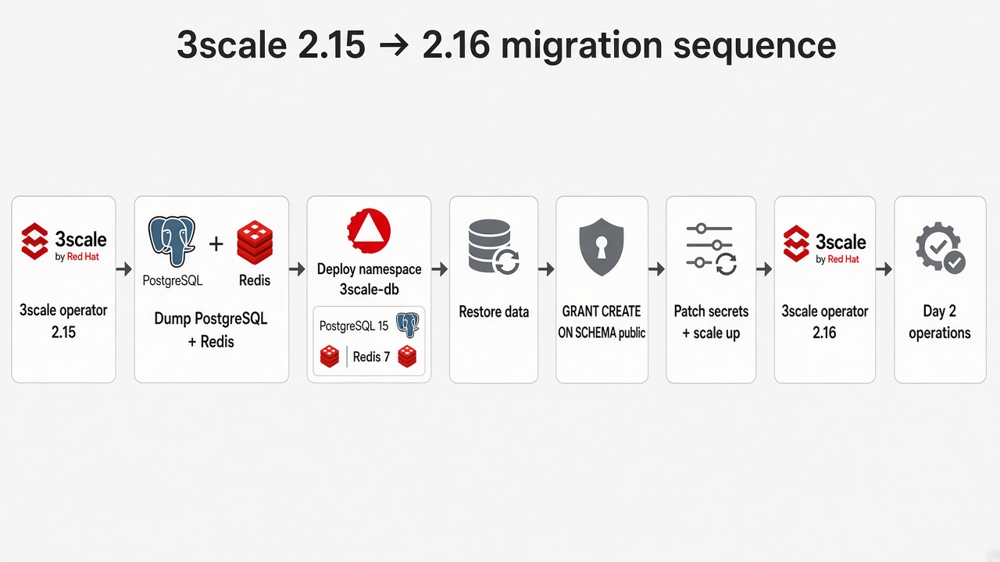
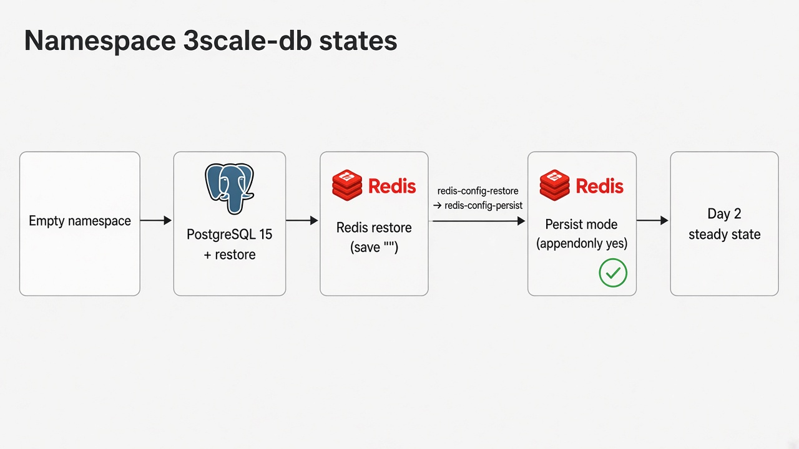

# Migration sequence

Linux/bash is the default. This page aligns with `docs/runbooks/00-secuencia-y-matriz.md` in the repository.

Complete [Prerequisites](prerequisites.md) before step 1.

## Order of operations





1. **Install 3scale 2.15** on a test cluster — 3scale operator + APIManager with embedded databases ([Install 3scale 2.15 (lab)](install-lab.md)).
2. **Confirm the matrix**: OpenShift version supported by both 2.15 and 2.16; latest CSV on channel `threescale-2.15`.
3. **Snapshot / backup** PVCs and secrets (`system-database`, `system-redis`, `backend-redis`).
4. **Open a maintenance window**: scale the 3scale operator and components to 0 **except** the database you are dumping.
5. **Externalize PostgreSQL** 10 → 15 in-cluster ([Externalize PostgreSQL](externalize-postgresql.md)).
6. **Externalize Redis** 6 → 7 in-cluster ([Externalize Redis](externalize-redis.md)).
7. Set `spec.externalComponents` on the APIManager (the PostgreSQL and Redis runbooks do this).
8. **Restore replicas**. Validate Admin Portal, Developer Portal, and APIcast.
9. **Upgrade the 3scale operator** to channel `threescale-2.16` ([Upgrade operator to 2.16](upgrade-216.md)).
10. **Upgrade OpenShift** afterwards, if needed, per [Supported Configurations](https://access.redhat.com/articles/2798521).
11. **Operate day 2** in `3scale-db`: `threescale.redis.configMode: persist`, backups, pinned digests ([Day 2 operations](day-2.md), [Credential rotation](credential-rotation.md)).

If a step fails before you delete embedded resources, see [Rollback](rollback.md).

!!! warning "Do not combine upgrades"
    Do not run the 3scale upgrade and the OpenShift upgrade in the same maintenance window.

## Value files

| File | When |
|------|------|
| `values-215.yaml` | Install. Channel `threescale-2.15`, embedded databases, `systemStorageClass: efs-sc`. |
| `values-cutover.yaml` | Maintenance window. External databases exist. 3scale still uses the embedded ones. Redis `configMode: restore`, no auth. |
| `values-216-external.yaml` | After restore and portal checks. Channel `threescale-2.16`, `externalComponents`, Redis auth, `configMode: persist`. |

`values-216-singlenode.yaml` is a different scenario. It installs 2.16 directly on one node and is not a 2.15 migration.

## Deploy

```bash
oc apply -f examples/pattern-cr/hub-215.yaml
./pattern.sh make load-secrets
```

During the window, set `extraValueFiles` to `/values-cutover.yaml`. After validation, set it to `/values-216-external.yaml`. See [Install with a Pattern CR](pattern-cr.md).
